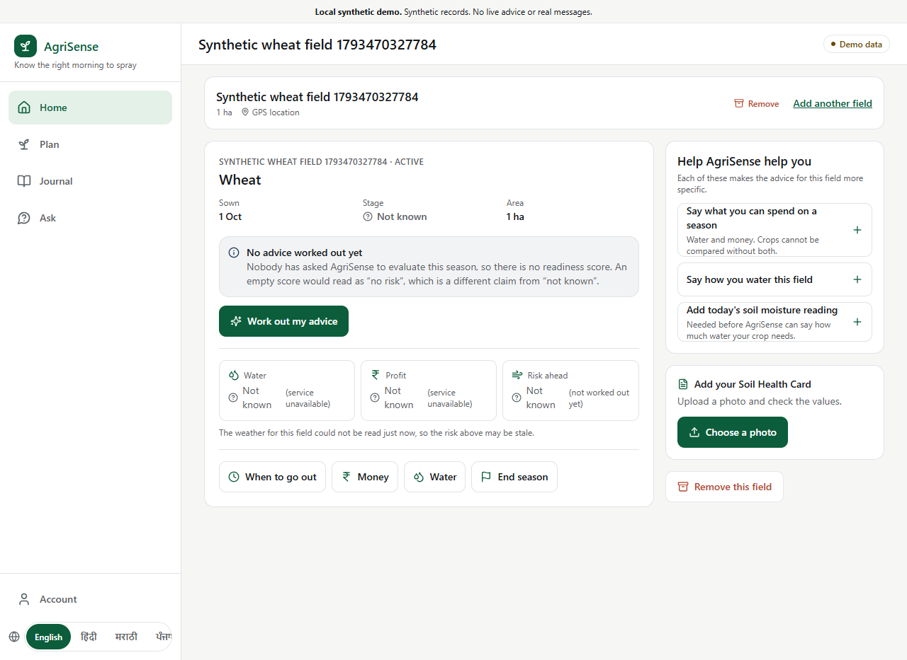
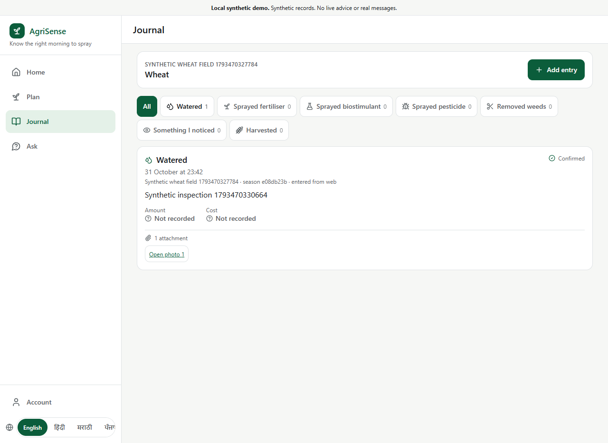
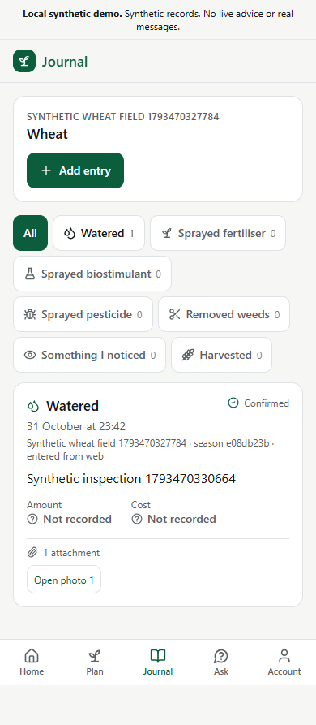
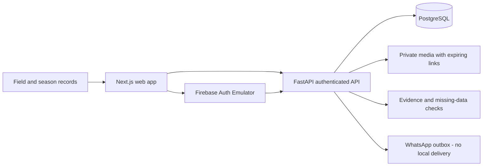

<p align="center"></p>

# AgriSense · a clearer record of the field

**A crop season brings together land, water, weather and many small decisions. AgriSense keeps that context in one place, with the evidence and uncertainty in view.**

Register a field, track its crop season and journal what happened. Explore planning, water and spending screens without turning missing observations into confident numbers. This is Team Underdawgs' agriculture prototype, preserved here as a personal contribution case study with a runnable synthetic local demo.

[Try it locally](#run-the-demo) · [My contribution](CASE_STUDY.md) · [Development](docs/DEVELOPMENT.md) · [Original team repository](https://github.com/annam-iitrpr/TeamUnderdawgs-Agrisense)



*The real application, Auth Emulator, API and PostgreSQL running together. All records in these captures are synthetic. Unavailable recommendations remain visible.*

## From a field to a season record

| Need | What the prototype does |
| --- | --- |
| Keep the field context | Progressive setup with location, area, crop and separate consent choices; switch between owned fields |
| Remember what happened | Season journal with notes, quantities, spending and owner-authorized photo uploads/viewing |
| Check a soil card | Upload, extraction job and editable human-confirmation flow; actual extraction requires a configured model |
| Explore a decision | Planning, readiness, water and money screens carry evidence and missing-data reasons |
| Use a familiar language | Shared navigation and selected feature controls in English, Hindi, Marathi, Punjabi and Telugu; coverage/review is partial |

<table><tr><td width="68%"></td><td width="32%"></td></tr></table>

## Run the demo

Install **Git** and **Docker with Compose v2**, using Linux containers. No cloud account or provider key is needed.

```sh
git clone https://github.com/Muneer320/AgriSense.git
cd AgriSense
git switch codex/cleanup-demo
docker compose -p agrisense-demo up -d --build --wait
```

Open **http://localhost:5176**. The first build downloads dependencies. Create a local account with the fictional number **+16505550123**, choose **Send code**, and read its generated verification code:

```sh
docker compose -p agrisense-demo logs --tail=30 auth
```

After sign-in, add a field using synthetic details, defer the optional soil card, add a crop season and save a journal entry. Reload to see it persist. A permanent notice identifies the synthetic demo; no SMS or WhatsApp message is sent.

See the [walkthrough and troubleshooting guide](docs/LOCAL_DEMO.md) for emulator URLs, storage, shutdown and the actual browser integration suite. Named volumes retain local records, media and gracefully exported emulator accounts across container recreation.

> [!IMPORTANT]
> This prototype is not validated agricultural advice. Spray windows require reviewed evidence; soil OCR and grounded assistant answers need a configured provider. Missing data must remain missing. The local demo does not verify the former public deployment, cloud access, real farmer use or outbound WhatsApp.

## How the pieces fit



The local demo uses a static production web export, real bearer-token verification and real database migrations. Python owns the scientific calculations; the browser renders their results. Authenticated API responses are not cached by the service worker.

<details>
<summary><strong>Verification and development</strong></summary>

The maintenance pass checks contracts, backend behavior, PostgreSQL migrations, the web export and a real emulator/API browser journey. The older contract-fixture browser suite is separate and is not counted as integration evidence. Exact checks, remaining lint/advisory debt and Windows commands are maintained in [DEVELOPMENT.md](docs/DEVELOPMENT.md) and [cleanup progress](workstreams/cleanup/progress.md).

Use Python 3.12 with uv and Node >=22.12 (CI uses Node 24). Generated Python/TypeScript contracts come from the shared contract definitions; do not patch them manually. Keep all credentials, account exports, media and browser authentication state outside Git.

</details>

<details>
<summary><strong>Scope, languages and integrations</strong></summary>

- Non-English terminology remains pending human review. Some explanatory copy, journal and agronomist screens remain English; WhatsApp conversation handling defaults to English.
- Gemini OCR/assistant, forecast services, Google Cloud infrastructure and Meta delivery have implementation paths but need their own configuration and verification. The Compose setup does not load a team credential file.
- Reference review, real labeled training outcomes and model promotion require external domain work. No invented coefficients or adoption claims are used to fill these gaps.
- A production operational/security review and farmer-facing privacy policy are still needed before collecting real records. The included local-only trust-authentication setup must not be exposed publicly.

The [case study](CASE_STUDY.md) explains the tradeoffs and contribution evidence. [Historical integration notes](docs/AGRISE_INTEGRATION_PLAN.md) and [team setup](docs/TEAM_SETUP_AND_MANUAL_TESTING.md) are retained for their original context.

</details>

## Team and contribution

Built by **Team Underdawgs**: [Muneer Alam](https://github.com/Muneer320), [Akasha Prasad](https://github.com/AkashaPrasad), [Anoushka Wayangankar](https://github.com/anoushkawayangankar), Jaideep and Hina. Original team history and contributor identities are preserved. This fork documents Muneer's work on farmer-facing integration, authentication, conversational workflows, delivery support and presentation with [specific commit evidence](CASE_STUDY.md).

Issues and focused pull requests are welcome in this fork. Read the [development guide](docs/DEVELOPMENT.md) and preserve scientific review flags and team attribution. No repository-wide license was supplied in the original project; no blanket permission to reuse team code is asserted here. Third-party dependencies and retained skill/reference files keep their own licenses.
